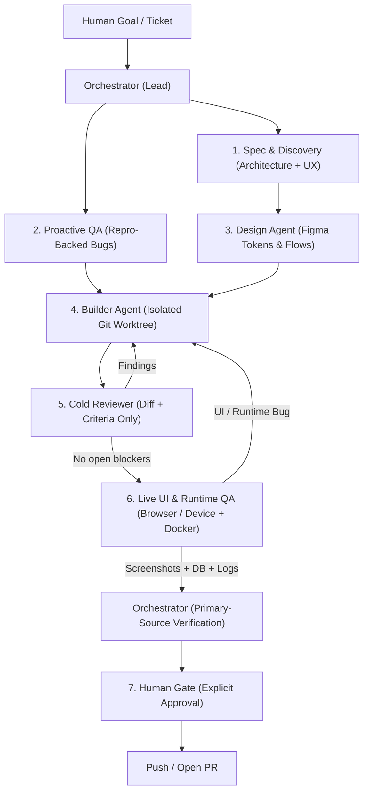

Most developers treat coding assistants like fast autocomplete: prompt a feature, glance at the diff, and fix whatever breaks after pushing. My **AI-native SDLC** works differently. Instead of one model generating and grading its own code, an orchestrator coordinates specialized agents across product specs, proactive bug reproduction, Figma design, model-tiered implementation, cold code review, and **live browser and device QA** before a pull request ever leaves my machine.

This workflow is the third layer of my engineering setup, building directly on [structuring FastAPI backends with `AGENTS.md`](/blog/fastapi-ai-agents-architecture) and [shipping version-accurate library `SKILL.md` specs](/blog/library-agent-skills-future-ai-coding). In this guide, I walk through the full seven-stage lifecycle across backend, web, and mobile, and cover:

- which models I use for which stage, and why I let **Gemini build while Claude reviews**;
- how I treat every agent report as a claim to verify, not a fact;
- how probes become **evals** that prove both the bug and the fix.

All of it comes with real numbers from one feature, where **1,262 passing tests** on the backend and **682 passing tests** on mobile still shipped to review with security blockers that only a cold, cross-model reviewer caught.

---

## The Closed-Loop AI-Native SDLC

Single-context prompting fails on real product features because of confirmation bias: the same context that wrote the code assumes its own edge cases are handled. When one agent writes the implementation, runs a happy-path check, and writes the summary claiming it works, blind spots survive all the way to CI or production.

Separating SDLC stages into isolated roles with explicit handoff contracts eliminates that blind spot:



Notice the feedback loops. Nothing moves straight from "unit tests pass" to `git push`. Review findings cycle back into the builder until resolved, and UI-visible changes must pass live runtime verification before I approve pushing a branch.

### SDLC Stage Matrix

| Stage | Agent Role | Isolation | Model Tier | Exit Gate |
|---|---|---|---|---|
| **1. Discovery & Spec** | Architect / Spec Agent | Read-only codebase access | Top-tier reasoning | Written spec covering UX flows, data/ledger invariants, and scoped tickets, **with the team's decisions recorded before any code** |
| **2. Proactive QA** | QA Sniffer Agent | Read-only + isolated test runner | Top-tier reasoning | Executable reproduction test + observed failure output |
| **3. UI & Design** | Design Agent | Figma + read-only codebase | Top-tier reasoning | Synced design tokens, component specs, and build handoff note |
| **4. Implementation** | Builder Agent | Dedicated sibling Git worktree | Fast worker by default; top-tier for money, auth, or migrations | Clean diff, passing lint, typecheck, regression tests, and local commits |
| **5. Code Review** | Cold Reviewer Agent | Fresh context (`git diff` + criteria only) | Pinned top-tier reasoning, ideally a **different model family** from the builder | No open blockers or should-fix findings after independent lint, test reruns, and adversarial probes (nits may remain as follow-ups) |
| **6. Live UI & Runtime QA** | Browser / Device QA Agent | Isolated stack + Playwright / Browser Use / in-ADE browser (web) or Android phone / emulator (mobile) | Verified against primary sources | Inspected screenshots, console/HTTP traces, and live PostgreSQL row proofs |
| **7. Release** | Human Engineer | Primary checkout untouched | Human | Explicit approval before `git push`, PR creation, comments, or merge |

Two loops run between stages that are easy to miss:

- **Spec gate.** The spec lists every proposed decision and open question. A teammate approves them, and the answers are written back into the spec doc, before the first line of code.
- **Contract sync.** When the backend settles its final error codes and fields, they go back to the design agent, which updates the Figma states *before* the mobile build starts. In this feature, a wrong passcode changed from 401 to 403 because the client refreshes and replays any 401, which would have counted one wrong guess twice. The designs were updated before a single mobile screen was built.

---

## Right-Sizing Orchestration: Three Execution Gears

Running a full multi-agent swarm for a two-file validation fix wastes tokens and wall-clock time. I scale the workflow across **three execution gears** based on scope and blast radius:

- **Gear 1 — Focused Single-Repo Ticket:** Read-only planning in the main session, implementation in a reused sibling worktree, and a cold reviewer subagent run against the final diff.
- **Gear 2 — Cross-Stack / Parallel Work (Backend + Mobile):** A coordinated multi-agent swarm with strict non-overlapping file ownership—two writers never touch the same file—followed by an isolated cold review once local commits land.
- **Gear 3 — Structured Verification & Audits:** Repeatable multi-probe checklists used for regression sweeps, security audits, or re-verifying open issues after teammates merge into the base branch.

---

## Model Tiering: Matching Reasoning Cost to Blast Radius

Not every stage needs the slowest, most expensive frontier model, and not every ticket is safe on a fast worker model. I route models intentionally by risk. This is the actual routing for the feature in this post:

| Stage | Model | Where it runs |
|---|---|---|
| Orchestration, spec, design, cold code review | Claude Opus 5.5 | Claude Code (desktop), one session per role |
| Backend build (auth, permissions, migrations) | Claude Opus 5.5 | Claude Code, in a sibling worktree |
| Mobile build and device QA | Gemini 4 Neon High | Antigravity, Orchestrator mode, every command approved by me |
| Small, well-specified tickets | Claude Sonnet or Gemini Flash | Claude Code, or Antigravity's CLI (`agy`) |

The rules behind the table:

- **Fast worker models for clear, scoped builds:** Well-specified tickets in a single repo that follow existing patterns and have strong test coverage go to fast worker models. They iterate quickly inside a worktree and keep costs low.
- **Hard 3-round review circuit breaker:** If a fast builder fails cold code review three times on the same issue, it stops automatically. The same worktree and open findings escalate to a stronger reasoning builder rather than burning another loop.
- **Top-tier reasoning pinned for high-leverage stages:** Planning, orchestration, architecture specs, proactive QA, cold code review, and any build touching **money, ledger invariants, authentication, passcodes, permissions, or database migrations** always run on top-tier reasoning models.

> **Pitfall to Avoid:** In orchestrator/worker setups, execution turns often run on a lighter model. In Antigravity's Orchestrator mode, the planning turn runs on the top model, but execution hands off to a Flash worker, so any subagent left on `inherit` silently drops to Flash. Your code reviewer and QA agents included. Always pin their model explicitly.

---

## Cross-Model Review: Gemini Builds, Claude Reviews

The idea I'd add to any agentic setup: **don't let the reviewer share the builder's model family.** Models from the same family tend to share the same blind spots. A reviewer from a different family, starting cold from the diff and the acceptance criteria, attacks the code from a different angle.

For the mobile half of this feature (a shared "counter device" mode for a payments app, where shop staff unlock a till with their own passcode), Gemini built it in Antigravity from a written brief, and Claude reviewed it cold.

Gemini's first version was green on everything static: `tsc --noEmit` exited 0, and **682 of 682 Jest tests passed**. Claude's review still came back with **"changes needed": 2 blockers, 1 high and 4 should-fix findings**, each proven by a probe test:

- **The owner's push notifications kept arriving on the shared till.** Turning the owner's phone into a counter never unregistered its push token, so payout and payment notifications for the owner would show on a device every cashier can see.
- **Owner data stayed on the shared device.** The owner's last login phone, biometric-login credentials and biometric payment key survived the handover. After any sign-out, the login screen opened with the owner's number filled in.
- **An expired counter session fell back to the owner login.** With a 12-hour idle limit on counter sessions, that would have happened every morning after a quiet night.
- **Unlock-renewal races.** A late renewal could kick the next cashier out, or overwrite a newer unlock.
- **A shared component changed for everyone.** To lay out the new tablet screens, Gemini changed *every* bottom sheet in the app on tablet and web, including date and country pickers for regular users, and nested one modal inside another.

Round 2 found three smaller issues:

- timers re-arming after the screen unmounted;
- the handover awaiting a network call while the owner was still signed in, for up to 45 seconds offline;
- a `429` at app start wiping the till's session.

Round 3: ready.

None of these were typos. They were all about **what is safe on a device that several people share**, which is exactly the kind of reasoning a builder skips when its tests are green.

---

## Case Study: 1,262 Green Tests, One Blocker

The backend half (built by Claude, reviewed by a separate, cold Claude session) shows the same pattern. All **1,262 tests passed** across five FastAPI services, plus lint. The cold review still found:

- **A blocker:** removing or resetting a staff member didn't end their current unlock. It stayed valid for up to an hour. The reviewer's probe showed the gateway still forwarding the removed staff member's ID on a payment request.
- **Weak passcodes accepted:** `0000` and `1234` were allowed as a staff member's first passcode, even though the repo already had a weak-PIN check.
- **A rolling-deploy break:** the new internal service signature and the old one rejected each other. During a `docker compose up -d`, old and new containers would have refused each other's requests for a few seconds and logged users out.

Round 2 found two more. The auto-lock was a fixed five minutes after unlocking instead of five minutes *without use*, so a busy cashier would re-enter their passcode mid-queue. And a payment-request reply still sent the payer's phone number to the shared till.

### Proving What SQLite Can't

The unit suite runs on SQLite, which ignores `SELECT … FOR UPDATE`, so it can't prove anything about concurrency. Once Docker was up, the reviewer ran four races against a real **PostgreSQL 16** container, each with 12 parallel requests through the real app:

| Race | Result |
|---|---|
| 12 wrong passcodes, limit 5 | Each counted exactly once, then locked |
| 12 device adds, cap 3 | Exactly 3 created |
| 12 staff adds, cap 3 | Exactly 3 created |
| One single-use Owner-PIN token, used 12 times | Exactly 1 device created |

Then the step most teams skip: a **control run**. With the row lock patched out, the same staff-add race created **12 of 12**. That proves the probe really exercises concurrency, and that the lock is what holds the cap.

---

## Trust Nothing an Agent Reports

Every agent report, from my own Claude sessions as much as from Gemini, is a **claim**, not a fact. The orchestrator's job is to check it against primary sources before relaying it. Real examples from this one feature:

- **"This test failure is pre-existing."** Gemini said a `jest --runInBand` crash wasn't its fault. I ran the same command on an untouched copy of `dev`: true, it crashes there too.
- **"698 of 698 tests pass."** My reruns failed one test at random in 3 of 4 runs. I traced it to an old test file that leaks a timer, then ran unchanged `dev` four times: it fails 1 run in 4 as well. Not the branch's fault, but now it's a known flake with an owner, rather than noise.
- **"Postgres races proven."** The reviewer's race output wasn't saved to files, so I started my own throwaway Postgres, reran its probes, and got the same numbers.
- **"Permission denied."** A Google Docs edit returned an error, but the content appeared anyway. Re-reading the doc instead of retrying avoided writing everything twice.
- **"Field names confirmed."** The design agent's API field names came from the spec, not from code. They stayed flagged as unconfirmed until the backend build named the real ones, and then the Figma states were corrected.
- **Role drift.** The device-QA agent ran on the emulator instead of the phone and committed a code fix mid-run. Both showed up in its transcript and `git log`, not in its summary. The fix happened to be good, but it still went through the same tests before the push.
- **"N/A" isn't "PASS".** The push-notification check couldn't be proven locally: the database showed zero push tokens registered, so there was nothing to stop. It's reported as not testable, not as passed.

---

## Probes as Evals

Code review findings in this loop aren't opinions. Each one ships with a **runnable probe**, saved outside the repo next to the review. That turns review into a small eval harness:

1. **The probe proves the bug.** It prints the bad state (for example, `token still valid, 3600 s left` after a staff member was removed) and asserts it.
2. **After the fix, the same probe is rerun.** It now prints the fixed state, and its old assertions fail: a failing probe is the good outcome.
3. **The builder turns each probe into a permanent regression test,** so the eval lives on in the suite.
4. **Control runs prove the eval can fail** (the lock-removed race above). An eval that can't fail proves nothing.
5. **Base-branch comparison** separates new failures from old ones before anyone is blamed.

The same data scores the agents themselves. Track review rounds and findings per round, per model:

| Build | Builder | Round 1 | Round 2 | Round 3 |
|---|---|---|---|---|
| Backend | Claude Opus 5.5 | 3 findings (1 blocker) | 2 should-fix | Ready |
| Mobile | Gemini 4 Neon High | 7 findings (2 blockers) | 3 should-fix | Ready |

That's what the three-round circuit breaker is measured against. It also tells me where each model needs a tighter brief next time.

---

## Cold Adversarial Review (And the Probes It Runs)

The single biggest quality upgrade in my SDLC is **cold review isolation**. The reviewer never reads the builder's step-by-step plan, internal notes, or explanation of why it thinks the code works.

Instead, the reviewer starts fresh with a strict brief containing only the acceptance criteria and `git diff origin/<base>..HEAD`:

```yaml
target:
  repo: ../app-squad-worktree
  diff_command: "git diff origin/dev..HEAD"
  acceptance_criteria:
    - "Idle timeout locks shared counter session after configured minutes"
    - "Revoked staff sessions fail closed with 401 and clear local state"
mandatory_probes:
  - "Test all new settings at non-default values (e.g. 72 instead of 24)"
  - "Verify rendered *_until / *_at expiries re-evaluate while screen stays mounted"
  - "Check overlapping open PRs and Alembic migration number collisions"
required_output:
  - "Verified lint + test counts from actual command runs"
  - "File:line findings ordered by severity, each with a probe and its output"
constraints:
  - "Do not push, open PRs, post GitHub comments, or modify primary checkouts"
```

Beyond reading the diff, the reviewer runs **three repeatable adversarial probes**:

1. **Non-default config invariance:** Every new or modified setting is tested at a non-default value (for example, `72` instead of `24`). The reviewer checks every endpoint, 4xx/5xx error message, notification, email, and client UI copy to ensure nothing hard-codes the default.
2. **Live timestamp expiry:** Any `*_until` or `*_at` timestamp rendered in the UI—holds, lockouts, or session expiries—must re-evaluate automatically via a timer or hook when the clock crosses that timestamp while the screen stays mounted, backed by fake-timer tests and unmount cleanup.
3. **Base-branch drift & migration collisions:** Before sign-off, the reviewer checks open PRs touching the same surface and migration sequence numbers. If teammates merged first, we rebase onto the updated base and scale re-verification to the paths that actually changed.

---

## Live UI Verification Across Web and Mobile

Unit tests mock DOMs, viewports, and network boundaries, so passing suites never guarantee a working UI. Depending on the target platform, the QA stage talks directly to the live running application rather than trusting mocked assertions:

### Web Applications (Browser Use, Playwright & In-ADE Browsers)

For Next.js and web dashboards, agents drive the real rendered UI using **Playwright**, **Browser Use**, or an **in-ADE built-in browser** (such as Antigravity's built-in browser agent or Claude's browser tooling):

- Walk through end-to-end user flows across desktop and mobile viewports against the live dev or Docker stack.
- Verify zero uncaught browser console errors, zero failed HTTP responses, and clean rendering for dynamic elements like charts, syntax-highlighted code blocks, and Mermaid SVGs.
- Visually inspect captured screenshots and cross-check backend container logs and PostgreSQL rows after form submissions or state mutations.

### Mobile Applications (Physical Devices & Emulators)

For React Native and Expo apps, agents boot an isolated Docker Compose backend alongside a physical USB-connected Android phone or an Android API 36 emulator over `adb`, driving real touch events, checking soft-keyboard/IME interactions, inspecting screenshots, and asserting raw HTTP traces and database state.

---

## Case Study: Green Suites, Broken Keyboard

The device run for the counter mode (12 checks, an isolated Docker Compose PostgreSQL + FastAPI backend, and an Android API 36 emulator at `1080×2400`) shows the other half of the story: what no unit test can see.

Before booting the emulator, every static check was green: `tsc --noEmit` exited `0`, and the Jest suite passed (705 tests, apart from the known flaky timer leak above, which also fails on `dev`).

Yet on Check 1—adding a staff member inside an `Add counter staff` `BottomSheet`—focusing the `Name` input opened Android's soft keyboard directly over both the `TextInput` and the primary `Add staff` CTA button. I spotted it while watching the run, and the device agent picked it up. Unit tests mock React Native components and viewport geometry, so none of them could see that the sheet stayed pinned behind the IME.

### Why It Happened

Expo apps on modern Android run edge-to-edge, meaning the window no longer resizes automatically when the soft keyboard opens. Our centered dialog wrapper (`ModalShell`) and screen wrapper (`ScreenContainer`) already handled this with `KeyboardAvoidingView`, and `app.json` kept default layout sizing (without `softwareKeyboardLayoutMode: "pan"`), as recommended in [Expo's keyboard handling guide](https://docs.expo.dev/guides/keyboard-handling/). `BottomSheet`, however, rendered a plain `View` inside `<Modal>`:

```tsx
// Before: plain View stays anchored at the bottom edge behind Android's IME
<Modal visible={shown} transparent animationType="slide" onRequestClose={onClose}>
  <View style={styles.backdrop}>
    <Pressable
      style={StyleSheet.absoluteFill}
      onPress={onClose}
      accessibilityLabel="Close"
    />
    <View
      style={[
        styles.sheet,
        { paddingBottom: Math.max(insets.bottom, spacing.lg) + spacing.md },
      ]}
    >
      <View style={styles.handle} />
      <Text style={styles.title}>{title}</Text>
      {children}
    </View>
  </View>
</Modal>

// After: KeyboardAvoidingView lifts the entire sheet cleanly above the soft keyboard
<Modal visible={shown} transparent animationType="slide" onRequestClose={onClose}>
  <KeyboardAvoidingView behavior="padding" style={styles.backdrop}>
    <Pressable
      style={StyleSheet.absoluteFill}
      onPress={onClose}
      accessibilityLabel="Close"
    />
    <View
      style={[
        styles.sheet,
        { paddingBottom: Math.max(insets.bottom, spacing.lg) + spacing.md },
      ]}
    >
      <View style={styles.handle} />
      <Text style={styles.title}>{title}</Text>
      {children}
    </View>
  </KeyboardAvoidingView>
</Modal>
```

### Closing the Loop

Instead of guessing or leaving a screenshot note on a PR, the loop ran all the way back through verification:

1. **Fix + regression test:** Wrapped `BottomSheet` in `<KeyboardAvoidingView behavior="padding">`, matching the existing wrappers, and added a unit assertion verifying `behavior="padding"` on default sheets.
2. **Full suite re-run:** Re-verified `tsc --noEmit` and the full Jest suite (705/705) independently from the orchestrator, not from the agent's report.
3. **Live emulator re-check:** Reloaded the app via Metro on the Android API 36 emulator, reopened `Add counter staff`, focused the `Name` input, and visually inspected the new screenshot to confirm the sheet title, input cursor, helper copy, and `Add staff` CTA all sat cleanly above the keyboard.
4. **Local commit (no push):** Committed the two-file fix on the feature branch, keeping the PR ready for final review before pushing.

Across the full 12-check run, device QA also verified:
- **Idle auto-lock:** locks after `1 min` without use;
- **Keepalive renewals:** `200 OK` across nearly 3 minutes of active tapping;
- **Passcode lockout:** `403` into `429` with zero silent token refreshes;
- **Remote revocation:** `DELETE` into `401`, with immediate sign-out and no stale phone pre-fill;
- **No PII on the till:** zero leakage on staff transaction rows, confirmed against the actual PostgreSQL rows.

One check stayed open: whether the owner's push notifications stop on a till can't be proven on a local emulator build that never registers for push. It's listed as not covered, not as passed.

All proof artifacts live outside the Git repository in a dedicated evidence directory: numbered screenshots plus text captures of HTTP responses, logs and SQL rows, with a README mapping each check to its proof:

```text
qa/bobby-device-2026-11-27-87-counter-device-mode/
├── README.md
├── 02b_check1_add_staff_sheet.png        # keyboard covering the input
├── 25_keyboard_fix_add_staff.png         # fixed
├── 06_check6_request_and_today.txt       # HTTP + DB proof for attribution
├── 21_check11_device_signed_out.png
└── 23_check11_login_no_prefill.png
```

---

## What Actually Breaks (And Five Non-Negotiable Guardrails)

Designing an agentic SDLC means engineering around what agents reliably get wrong in practice:

- **Optimistic status claims:** Builder models sometimes report expected lint or test results instead of actual command output (for example, claiming lint passed when a formatter still modified a file). Every claim is re-run and verified from raw output before advancing.
- **Green tests, unsafe behaviour:** Both builds in this post passed every test while still leaking owner data to a shared device or keeping removed staff unlocked. Tests prove what someone thought to test; a cold reviewer asks what nobody thought of.
- **Context contamination:** Sharing builder reasoning with the reviewer anchors the audit on the builder's assumptions. Keeping the reviewer cold, and ideally on a different model family, catches missing edge cases immediately.
- **Scope creep in shared code:** Agents happily "improve" shared components to make their feature work, changing behaviour for every other screen. Reviewers diff shared components against the base branch explicitly.
- **Workspace tangling and coordination tax:** Letting agents edit active checkouts or spawn heavy swarms for trivial edits creates merge messes and slow feedback. Sibling worktrees and right-sized gears keep velocity high.

Five non-negotiable guardrails keep the entire loop reliable:

1. **Isolated worktrees only:** Agents never edit, switch branches, or stash in my primary checkouts. Every build runs in a dedicated sibling worktree.
2. **Cold, unanchored reviews:** Reviewers evaluate acceptance criteria and the raw `git diff`, never the builder's narrative.
3. **Primary-source verification:** "Tests pass" or "layout fixed" means nothing without observed command output, database query rows, HTTP logs, and inspected screenshots.
4. **Human-gated outward actions:** Agents never run `git push`, open or merge PRs, post comments, or file issues without explicit approval—and commits always carry clean human authorship without AI attribution trailers. Even a typo in a commit message is fixed before the push, by rebuilding the commit with an identical tree.
5. **External evidence folders:** Screenshots, HTTP transcripts, probes, and database proofs live in an untracked `qa/` folder outside the repositories so diffs stay surgical.

> **Key Takeaway:** An AI-native SDLC isn't about replacing engineering rigor with faster code generation. It's about automating the spec-build-review-verify feedback loop, across more than one model, so bugs like covered mobile inputs, leaked owner data, and stale sessions are caught and proven fixed **before** a single commit leaves your machine.

---

## What Changes When You Engineer Like This

When architecture specs, model-tiered builds, cross-model cold reviews, probe-based evals, and live browser and device E2E proof run inside the local development loop instead of after a PR is opened, pull requests become boring in the best way. Every UI change ships with visual proof on a real viewport, every backend invariant is backed by observed logs and PostgreSQL state, and human review stays focused on product and architecture decisions rather than catching missing keyboard wrappers.
